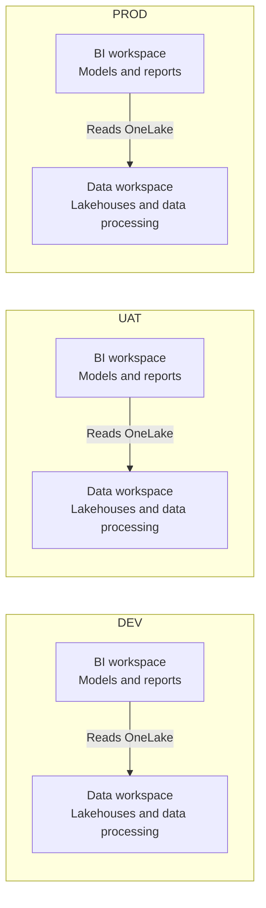
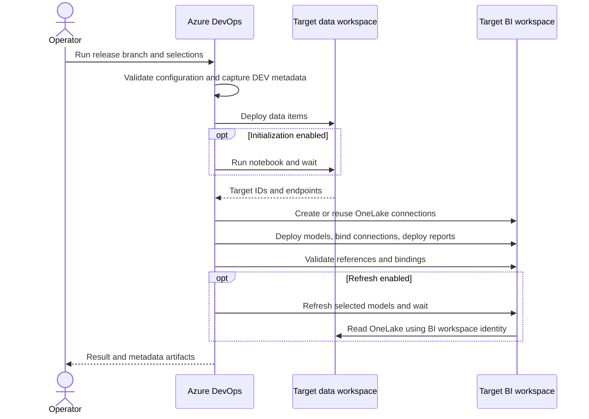

# Fabric CI/CD setup

## Architecture

Each environment has two workspaces: **data** holds lakehouses, notebooks, and
pipelines; **BI** holds semantic models and reports. BI models read OneLake data
from their environment's data workspace.

DEV workspaces sync to the same Git repository using separate roots:
`workspaces/data` and `workspaces/bi`. Azure DevOps deploys those definitions to
UAT and PROD; it does not copy data between environments. Target BI models access
OneLake using their BI workspace identity, with SSO disabled.



## 1. Create workspaces

Create capacity-backed data and BI workspaces for DEV, UAT, and PROD.

| Environment | Deployment method |
|---|---|
| DEV | Git integration on `main` |
| UAT | Pipeline from `uat/<version>` |
| PROD | Pipeline from `prod/<version>` |

Record each workspace's name and ID. Do not configure Git synchronization on UAT
or PROD; the pipeline manages them.

## 2. Connect DEV to Git

In **Workspace settings > Git integration**, connect both DEV workspaces to the
same repository and `main` branch:

| Workspace | Git folder |
|---|---|
| DEV data | `workspaces/data` |
| DEV BI | `workspaces/bi` |

Keep these two roots. Organize their contents as needed. Example:

```text
workspaces/
  data/
    parameter.yml
    project_a/
      project_a_lakehouse.Lakehouse/
      initialize_data.Notebook/
    project_b/
      project_b_lakehouse.Lakehouse/
  bi/
    parameter.yml
    project_a/
      project_a_model.SemanticModel/
      project_a_report.Report/
    project_b/
      project_b_model.SemanticModel/
```

Replace the example items with your own Fabric-generated definitions. Preserve
their `.platform` metadata and relative report-to-model paths.

- Use **Direct Lake on OneLake**, with one GUID-based lakehouse source per model.
- Keep lakehouse names identical across environments; their IDs will differ.
- Keep reports linked by relative path to models under the BI root.
- Synchronize DEV definitions to Git before releasing. Source GUIDs must match
  the DEV inventory.
- SQL-endpoint-backed models, Import/DirectQuery partitions, multiple lakehouse
  sources, and cross-workspace report models are not supported by this BI flow.

## 3. Configure identities and permissions

### Pipeline identity

1. In **Azure DevOps > Project settings > Service connections**, create an
   **Azure Resource Manager** service connection using a service principal.
   Prefer workload identity federation; secret-based authentication is also supported.
2. Enable the applicable Fabric/Power BI service-principal API tenant settings.
3. Give the principal permission to read DEV metadata and deploy/manage target
   items, connections, notebook runs, and refreshes.
4. Authorize the pipeline to use the service connection. Add approvals/checks for PROD.

Azure subscription permissions alone do not grant Fabric workspace access.
Git integration must also be enabled in the Fabric tenant.

### BI data-access identity

1. In each target BI workspace, open **Workspace settings > Workspace identity**
   and create an identity.
2. Grant it **Read + ReadAll** on the target data lakehouses, or an appropriate
   OneLake security role.

For empty targets, grant access after the first data deployment. Repeat for new
lakehouses. The pipeline does not create identities or grant lakehouse access.

The service connection principal deploys items; the **BI workspace identity**
reads OneLake data. They are separate identities. Data workspace Viewer access
alone is insufficient for OneLake data access.

## 4. Set pipeline variables

Create and authorize **Pipelines > Library** variable groups named `fabric-uat`
and `fabric-prod`.

| Variable | Value |
|---|---|
| `sourceDataWorkspaceId` / `sourceDataWorkspaceName` | DEV data workspace GUID/name |
| `sourceBiWorkspaceId` / `sourceBiWorkspaceName` | DEV BI workspace GUID/name |
| `targetDataWorkspaceId` / `targetDataWorkspaceName` | UAT or PROD data workspace GUID/name |
| `targetBiWorkspaceId` / `targetBiWorkspaceName` | UAT or PROD BI workspace GUID/name |
| `azureServiceConnection` | Authorized service connection name |
| `groupId` | Optional single Entra group object ID; otherwise empty |
| `userIds` | Optional comma-separated Entra user object IDs; otherwise empty |

Both groups use the same DEV pair and their own target pair. Configure all four
workspace name/ID pairs even for data-only or BI-only runs; IDs must be distinct.
Capture resolves the name first, then verifies the ID.

The optional group/users receive **connection Owner** access, not workspace or
lakehouse access. Existing lower direct connection roles are upgraded to Owner.

## 5. Select items

Update the [data selection](.deploy/config/data_selection.yml) and
[BI selection](.deploy/config/bi_selection.yml) to match your projects.

To deploy both example projects, use this in each file:

```yaml
folders:
  - project_a
  - project_b
```

To deploy one folder plus an individual BI model:

```yaml
folders:
  - project_a
files:
  - project_b_model.SemanticModel
```

- Folder paths are relative to the data or BI root and include descendants.
- Individual items use `displayName.itemType`, not filesystem paths.
- Dependencies must be selected or already deployed.
- Missing items and empty selections fail.
- `full` mode ignores selections and deploys all supported items in the chosen root.
- Neither mode deletes orphaned target items.

Commit selections with definitions. The branch pins the version; selections choose
the scope. No version-specific selection filenames are needed.

## 6. Create and run the pipeline

In **Azure DevOps > Pipelines > New pipeline**, select your repository,
choose **Existing Azure Pipelines YAML file**, and select
[azure-pipelines.yml](azure-pipelines.yml).

Commit and push your changes, then create a UAT branch:

```powershell
git fetch origin
git push origin origin/main:refs/heads/uat/1.0
```

Select `uat/1.0` under **Run pipeline > Branch/tag**. The pipeline is manual and
accepts only `uat/<version>` or `prod/<version>` branches, not `main` or tags.

| Parameter | Default | Purpose |
|---|---|---|
| `deploymentScope` | `both` | `data`, `bi`, or `both` |
| `deploymentMode` | `selective` | Selection files or `full` root deployment |
| `dataDeployConfig` | `.deploy/config/data_selection.yml` | Data selection |
| `biDeployConfig` | `.deploy/config/bi_selection.yml` | BI selection |
| `runInitializeData` | `true` | Run one target data initialization notebook |
| `initNotebookName` | Repository sample name | Override with your notebook's display name |
| `refreshSemanticModels` | `false` | Refresh selected BI models after validation |

### First deployment to an empty target

1. Run with `deploymentScope: data`.
2. Set `initNotebookName` to your notebook, or disable initialization.
3. Grant the target BI identity access to the new lakehouses.
4. Populate and verify the tables required by the models.
5. Run the same release commit with `deploymentScope: bi`.
6. Enable refresh only when the target data is ready.

For later releases, use `both` when lakehouse permissions are already configured.
Repeat the two-run process when new lakehouses need access grants.

Initialization and refresh are independent. The notebook must be selected or
already deployed. BI-only runs skip initialization; data-only and report-only
runs do not refresh models. Deploying definitions does not populate tables.

## Release call flow



BI-only runs read existing data metadata instead of deploying data. In combined
runs, a failed data stage blocks BI.

## 7. Validate and promote

Check the final pipeline result, model queries, report rendering, consumer
permissions, and RLS/OLS. In model **Gateway and cloud connections** settings,
verify the target OneLake connection, workspace identity authentication, and
disabled SSO.

Promote the tested UAT commit, not a newer `main` commit:

```powershell
git fetch origin
git push origin origin/uat/1.0:refs/heads/prod/1.0
```

Queue `prod/1.0` with the tested selections and deployment mode. Bootstrap empty
PROD targets using the same data-first sequence. Keep release branches unchanged
during testing and promotion; enforce approvals through Azure DevOps policies.

## Mapping and refresh behavior

- Connections are inferred from checked-in model OneLake GUIDs and matched to
  target lakehouses by name. No manual connection mapping file is required.
- Models using the same lakehouse share a connection named
  `onelake-<environment>-<target-data-workspace-guid>-<target-lakehouse-guid>`.
- Connections use `WorkspaceIdentity` authentication with SSO disabled.
  Existing connections with incompatible settings fail validation.
- Parameters and dependency manifests are generated during the run and published
  in `data_metadata` / `bi_metadata`; they are not committed back to Git.
- Validation always runs. Optional transactional full refresh runs sequentially
  after validation, with a 10-minute timeout per model.
- Refresh failures/timeouts fail the task. A timeout does not cancel the refresh;
  check Refresh history before retrying.
- Definition and refresh polling support trusted regional operation URLs through
  the public Fabric/Power BI endpoints.
- No automatic rollback occurs. Data, permissions, credentials, schedules, and app
  settings are not migrated with item definitions.

## Troubleshooting

| Failure | Check |
|---|---|
| Invalid release branch | Select `uat/<version>` or `prod/<version>`. |
| Missing variables or workspace resolution failure | Check group authorization, all workspace name/ID pairs, tenant, and principal access. |
| Missing selected item | Match selections to the release commit, not the example names above. |
| `items_to_include` warning | Expected in selective mode; verify dependencies are included or deployed. |
| Missing lakehouse or unmapped source | Deploy data first, match lakehouse names, and sync current DEV GUIDs to Git. |
| Connection/data-access failure | Check BI identity, lakehouse permissions, authentication, and SSO. |
| Missing notebook | Override `initNotebookName`, deploy the notebook, or disable initialization. |
| Refresh skipped | Expected when refresh is disabled; validation still runs. |
| Refresh fails after HTTP 202 | Acceptance is not completion. Check logged response headers, Refresh history, data readiness, and permissions. |
| Publish succeeded but task failed | Inspect later validation/refresh errors; publication is not rolled back. |

Never include tokens, client secrets, or Authorization headers in error reports.

## Local checks

The pipeline uses `windows-latest`, Python 3.11, PowerShell 7, Azure CLI,
dependencies from [requirements.txt](.deploy/requirements.txt), and the latest
Fabric CLI by default.

Run regression tests locally with Python and PowerShell 7 available:

```powershell
python -m pip install -r .deploy\requirements.txt
python -B -m unittest discover -s tests -p test_deployment.py -v
```

Tests do not contact Fabric. Use the pipeline for releases:
[deploy_fabric.py](.deploy/deploy_fabric.py) alone does not perform the full orchestration.

## References

- [Fabric Git integration](https://learn.microsoft.com/fabric/cicd/git-integration/git-get-started)
- [Workspace identity authentication](https://learn.microsoft.com/fabric/security/workspace-identity-authenticate)
- [Direct Lake security](https://learn.microsoft.com/fabric/fundamentals/direct-lake-security-integration)
